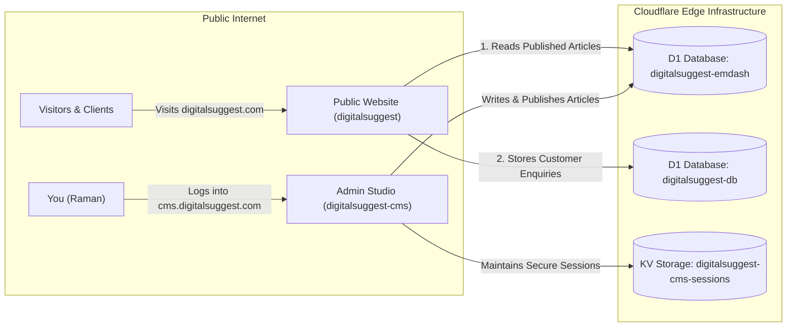
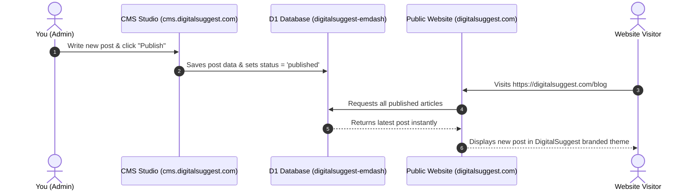

# DigitalSuggest CMS & Website Architecture & Security Guide

This document is a comprehensive, non-technical reference explaining how your website and Content Management System (CMS) are structured, how they communicate, where your data is stored, the security protections in place, and how you can use the CMS daily.

---

## 1. High-Level Architecture (The Big Picture)

Your web presence is divided into two separate, specialized systems hosted on Cloudflare's global edge network:

---

## 2. Repositories & Where Everything Lives

You have two separate repositories on GitHub:

| Component | GitHub Repository | Live URL | Purpose |
| :--- | :--- | :--- | :--- |
| **Main Website** | [`raman230298/digitalsuggest`](https://github.com/raman230298/digitalsuggest) | [`https://digitalsuggest.com`](https://digitalsuggest.com) | The public-facing agency website. Fast, lightweight, SEO-optimized, with no admin or editor code. |
| **CMS Studio** | [`raman230298/digitalsuggest-cms`](https://github.com/raman230298/digitalsuggest-cms) | [`https://cms.digitalsuggest.com`](https://cms.digitalsuggest.com) | The private admin panel and editor studio where you write, edit, and publish content. |

> [!NOTE]
> **Why two repositories instead of one?**
> Keeping the CMS in its own repository means the main website has **zero** admin endpoints, **zero** editor code, and **zero** login routes. Even if someone inspects the public website's code, there are no admin panels or authentication backdoors to target.

---

## 3. Databases: Where Your Data Lives

Your data is stored in Cloudflare's serverless edge database (D1), which automatically replicates across Cloudflare's global data centers:

### 1. `digitalsuggest-emdash` (CMS Database)
- **Database UUID:** `061ed55d-e3c1-4290-a705-5fe6913ba1ab`
- **What it stores:**
  - All blog articles, titles, excerpts, and rich-text content.
  - Categories, tags, and taxonomies.
  - Media metadata and upload references.
  - Your encrypted biometric passkey credentials.
- **Access:**
  - **CMS Studio:** Read & Write access (allows you to create, update, and publish).
  - **Public Website:** Read-only access (reads published articles to show them to visitors).

### 2. `digitalsuggest-db` (Leads & Enquiries Database)
- **Database UUID:** `4ef1f2d7-28f9-4927-b555-996826edb5ac`
- **What it stores:**
  - Client contact form submissions and project enquiries.
- **Access:**
  - **Public Website:** Write-only via parameterized contact API.
  - **CMS Studio:** Disconnected (the CMS cannot access or modify client leads, keeping customer data isolated).

### 3. `digitalsuggest-cms-sessions` (Session KV Storage)
- **Namespace ID:** `208971ab196a4f5994d4598d5c173ee8`
- **What it stores:**
  - Temporary authenticated login sessions for your browser. When you verify via biometric passkey, your login token is saved here.

---

## 4. How the CMS is Linked with the Website

When you write and publish an article in the CMS, here is how it appears on your website without any manual file copying or code editing:

1. **Instant Publishing:** As soon as you click **"Publish"** in the CMS, the article status in `digitalsuggest-emdash` becomes `published`.
2. **Dynamic Reading:** When visitors browse `https://digitalsuggest.com/blog`, the website fetches the published articles from the shared database and applies your brand's styling, headers, and footer automatically.
3. **Draft Safety:** Any article you are working on that is saved as a **"Draft"** remains invisible to the public until you choose to publish it.

---

## 5. Security Audit & Protection Measures

Security is designed with an enterprise-grade "defense-in-depth" architecture:

### A. Authentication Security (Passkeys)
- **Zero Passwords:** The CMS does not use traditional text passwords. There is no password to forget, guess, bruteforce, or leak from a database breach.
- **Hardware-Backed Biometrics:** Login uses **WebAuthn / FIDO2** (Windows Hello, Apple Touch ID, or hardware security keys). The private key never leaves your physical device's secure enclave chip.
- **Phishing Protection:** The browser strictly verifies that authentication is only valid for `cms.digitalsuggest.com`. Even if a hacker sets up a fake lookalike website, your browser will refuse to send the passkey.

### B. Network & Infrastructure Security
- **No Traditional Server / No Open Ports:** Both systems run on Cloudflare Workers and Pages micro-isolates. There are **no Linux servers**, **no open SSH ports (port 22)**, and **no exposed database ports (3306/5432)** to attack.
- **Cloudflare WAF & DDoS Shield:** All incoming traffic passes through Cloudflare's Web Application Firewall (WAF) to filter out automated attacks, scrapers, and volumetric DDoS floods.
- **Strict TLS 1.3:** All data in transit is encrypted using modern HTTPS (TLS 1.3).

### C. Database & Code Security
- **SQL Injection Immune:** All database queries in both the CMS and website use parameterized prepared statements (`?` bindings). User inputs are treated strictly as data, never as executable SQL commands.
- **Database Isolation:** Client enquiries (`digitalsuggest-db`) and CMS content (`digitalsuggest-emdash`) reside in separate database instances, ensuring that CMS operations cannot compromise customer contact records.
- **Setup Lockout:** The initial setup wizard has been permanently locked in the database (`emdash:setup_complete: true`). No outside user can trigger or rerun the setup flow.

---

## 6. What You Can Do With Your CMS

Now that your CMS is set up and active, you have full control over your content through a modern visual interface:

1. **Create & Edit Blog Posts:**
   - Full rich-text visual block editor (headings, paragraphs, bullet points, callout boxes).
   - Add SEO titles, custom slugs (URLs), meta descriptions, and excerpts.
   - Assign featured images for social sharing and blog cards.
2. **Organize Content:**
   - Create and assign Categories and Tags (e.g. *SEO*, *AI & Software*, *Digital Growth*).
3. **Media Management:**
   - Upload images and banners directly from your computer; they are stored on Cloudflare's edge CDN for instant loading.
4. **Drafts & Scheduling:**
   - Save drafts privately and preview your layout before making it live to the world.
5. **Multi-User Collaboration (Optional):**
   - In the future, you can invite co-authors or editors with specific permissions (e.g. contributor vs editor) without giving them full administrator rights.

---

## 7. Quick Reference: Important URLs

| Link | Purpose |
| :--- | :--- |
| **[CMS Login](https://cms.digitalsuggest.com/_emdash/admin/login)** | Open this to log into your CMS studio using your registered passkey. |
| **[Public Website](https://digitalsuggest.com)** | Your main homepage. |
| **[Public Blog](https://digitalsuggest.com/blog)** | Where all your published articles appear automatically. |
